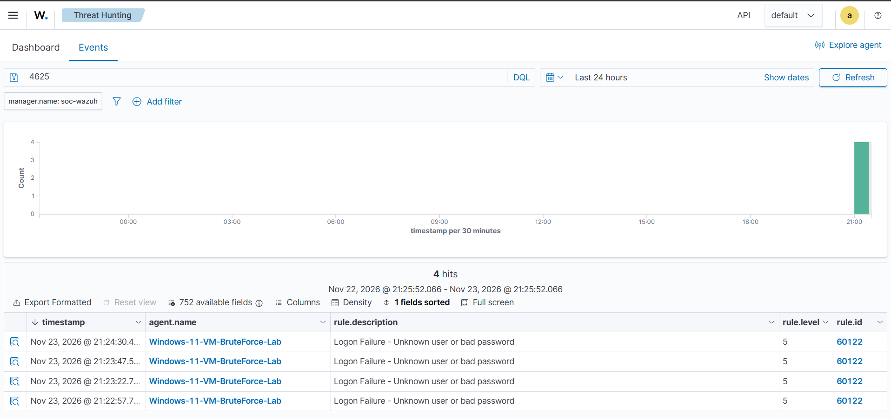
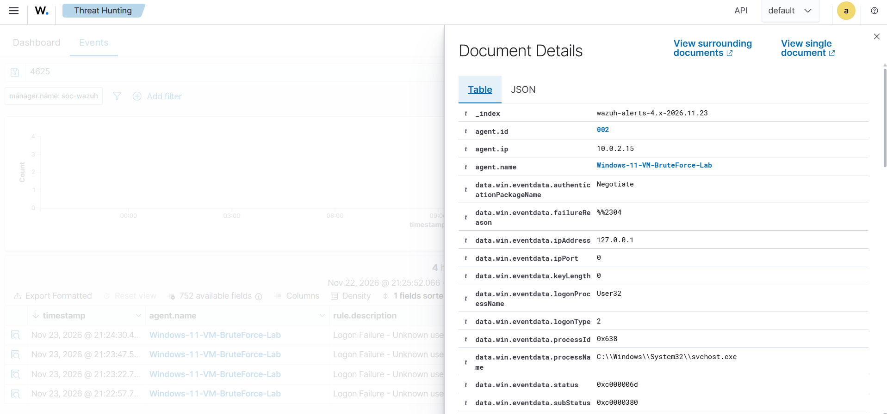
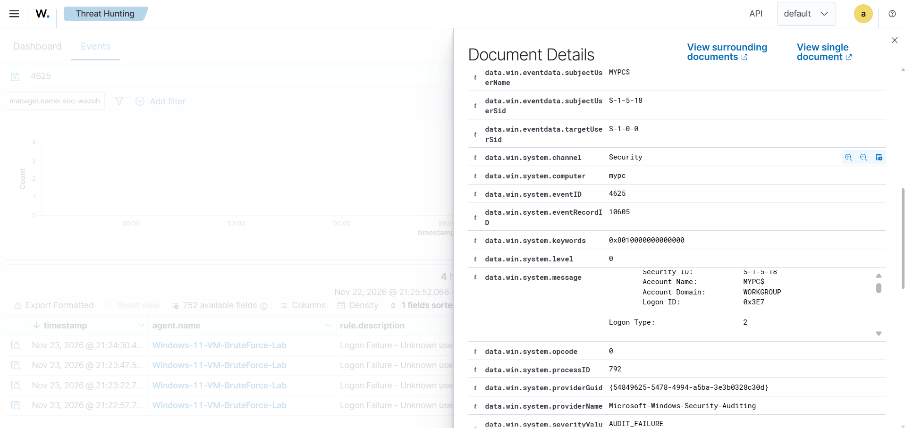
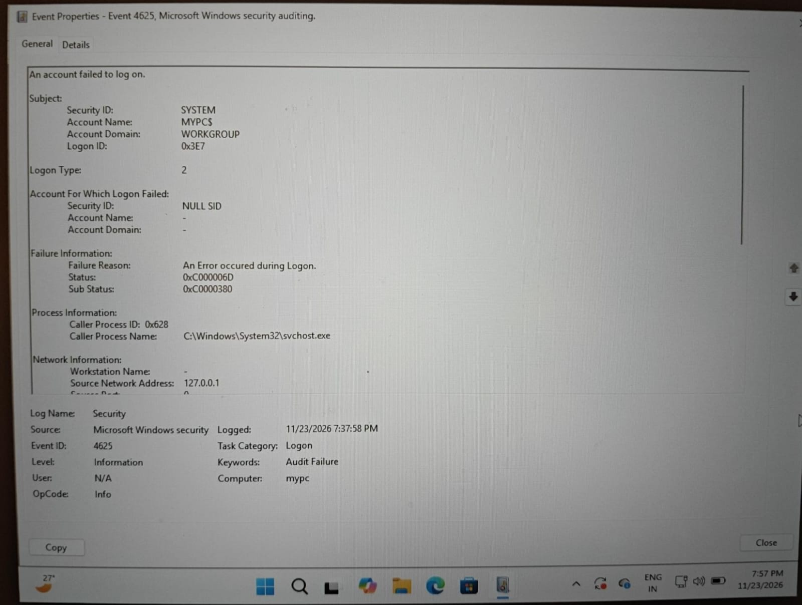

# Windows Brute Force Detection & Investigation Using Wazuh SIEM

## Overview

This project demonstrates the detection and investigation of Windows failed logon events using Wazuh SIEM in a cybersecurity home lab.

Controlled incorrect login attempts were generated on a Windows 11 virtual machine. Windows Security Event ID 4625 logs were collected by the Wazuh agent, analyzed in the Wazuh dashboard, and investigated to understand the authentication activity.

## Objectives

- Generate controlled failed authentication events.
- Collect Windows Security logs using Wazuh Agent.
- Detect failed logon activity using Wazuh SIEM.
- Investigate Event ID 4625.
- Analyze authentication details and event fields.
- Map the simulated activity to MITRE ATT&CK.
- Document findings and investigation evidence.

## Lab Environment

| Component | Details |
|---|---|
| SIEM | Wazuh |
| Target OS | Windows 11 VM |
| Wazuh Agent | Windows-11-VM-BruteForce-Lab |
| Agent ID | 002 |
| Event ID | 4625 |
| Virtualization | VirtualBox |
| Log Source | Windows Security Event Log |

## Lab Architecture

```text
Windows 11 Virtual Machine
        │
        │ Failed Login Attempts
        ▼
Windows Security Event ID 4625
        │
        ▼
Wazuh Agent
        │
        ▼
Wazuh Manager
        │
        ▼
Wazuh Dashboard
        │
        ▼
Alert Detection & Investigation
```

## Detection

Wazuh detected failed authentication events with the following alert details:

| Field | Value |
|---|---|
| Event ID | 4625 |
| Event Description | An account failed to log on |
| Wazuh Rule ID | 60122 |
| Rule Level | 5 |
| Alert | Logon Failure – Unknown user or bad password |
| Logon Type | 2 – Interactive |
| Source IP | 127.0.0.1 |

## MITRE ATT&CK Mapping

| Tactic | Technique | ID |
|---|---|---|
| Credential Access | Brute Force | T1110 |
| Credential Access | Password Guessing | T1110.001 |

**Mapping context:** This technique mapping represents the controlled failed-login simulation performed in this lab. The collected Event ID 4625 logs confirm failed authentication activity, but do not independently prove a real brute-force attack.

[MITRE ATT&CK – Password Guessing](https://attack.mitre.org/techniques/T1110/001/)

## Investigation Findings

- Failed authentication events were successfully generated.
- Wazuh collected Windows Security logs from the Windows 11 VM.
- Event ID 4625 alerts were detected in Wazuh.
- The activity was associated with Logon Type 2.
- The source IP address was 127.0.0.1.
- The target username and domain were not populated in the analyzed event.
- The events were reviewed in both Wazuh and Windows Event Viewer.

## Evidence

### 1. Wazuh Alert Overview



### 2. Event Details



### 3. Account Fields



### 4. Windows Event Viewer



## Detailed Investigation Report

For the complete investigation, event details, findings, and analysis:

[View Event ID 4625 Investigation Report](investigations/event-4625-investigation.md)

## Tools Used

- Wazuh SIEM
- Windows 11
- Windows Event Viewer
- VirtualBox

## Conclusion

This project demonstrates a basic SOC investigation workflow involving Windows authentication logs, SIEM detection, alert analysis, and documentation.

The lab successfully detected and investigated failed logon events using Wazuh. While repeated failed logons can be associated with brute-force activity, the available evidence was not sufficient to confirm a malicious attack.

---

**Disclaimer:** This project was conducted in a controlled cybersecurity home lab for educational purposes.
